# PRD di ScuolaChill · Team Andrea Rossi

## Informazioni sul documento

|              |                                                     |
| ------------ | --------------------------------------------------- |
| **Prodotto** | ScuolaChill                                         |
| **Team**     | Andrea Rossi — sviluppo individuale                 |
| **Autori**   | Andrea Rossi                                        |
| **Versione** | 0.3                                                 |
| **Data**     | 09/10/2026                                          |
| **Stato**    | Bozza                                               |

### Storico delle versioni

| Versione | Data       | Autore       | Cosa è cambiato e perché                   |
| -------- | ---------- | ------------ | ------------------------------------------ |
| 0.1      | 23/09/2026 | Andrea Rossi | Organizzato secondo il template ufficiale. |
| 0.2      | 09/10/2026 | Andrea Rossi | Aggiunte le storie STU-04 (media per materia) e UTE-01 (attivazione account). DIR-01 e UTE-01 passano dall'invio delle credenziali via email a un link di attivazione, perché una password inviata per email non è sicura. Seconda parte riscritta secondo il template (Stima del carico, Scelte tecnologiche). Backend cambiato da ASP.NET Core a Node.js + Express, per usare lo stesso linguaggio del frontend. Costi mensili verificati sul listino Azure: ≈ 50 € senza IVA (≈ 61 € con IVA), contro i 60-80 € stimati prima. |
| 0.3      | 09/10/2026 | Andrea Rossi | Aggiunta la parte Architettura (livelli, API, dati, sicurezza, qualità), il dimensionamento con costi, il piano di deployment e la Terza parte (milestone e valutazione). Aggiunti requisiti non funzionali e assunzioni, vincoli e dipendenze richiesti dalla checklist. Deciso il comportamento della consegna con connessione che cade. |

---

### Perché esiste ScuolaChill

**Dal lato business.** ScuolaChill unifica tutte le attività necessarie per gestire classi, studenti, materiale scolastico e comunicazioni in un solo sistema, dando a ciascun ruolo solo ciò che gli serve e semplificando l'accessibilià
alla piattaforma.

**Dal lato tecnico.** Applicazione web full stack con tre ruoli (Direttore, Docente, Studente), API REST autenticate a token, dati relazionali persistiti su un database gestito, distribuita su cloud pubblico e raggiungibile per il collaudo reale con studenti, direttore e un docente.

### Cosa è incluso

- Creazione degli account di docenti e studenti da parte del Direttore
- Creazione delle classi e loro composizione (studenti, docenti per materia)
- Vista d'insieme della scuola per il Direttore (classi, docenti, studenti, andamento voti)
- Caricamento di materiale didattico da parte dei docenti, per classe e materia
- Creazione di verifiche e assegnazione voti da parte dei docenti
- Consultazione del materiale, svolgimento delle verifiche e consultazione dei propri voti da parte degli studenti
- Autenticazione e autorizzazione basata su ruolo, applicata sempre lato backend

### Cosa non è incluso

- Gestione di assenze e presenze
- Comunicazioni DIRETTE con le famiglie
- Gestione di pagamenti o rette
- Orario delle lezioni (timetabling settimanale)

## Stakeholder

| Stakeholder | Cosa fa | Cosa gli interessa | Come è coinvolto |
| --- | --- | --- | --- |
| Direttore | Dirige l'istituto; crea account e classi; ha visibilità completa. | Una vista d'insieme affidabile, senza dover entrare in ogni singola classe. | Intervista iniziale sulle assunzioni della scuola + collaudo finale. |
| Docenti | Insegnano una o più materie in una o più classi; caricano materiale; creano verifiche, valutano. | Uno strumento che non aggiunga lavoro rispetto a email/Excel; caricare materiale, assegnare, veloce. | Collaudo con un docente reale dell'istituto. |
| Studenti | Consultano il materiale, svolgono le verifiche, controllano i propri voti. | Un'interfaccia semplice, usabile da smartphone, senza ambiguità. | Collaudo con i ragazzi del primo anno. |
| Docente del corso | Valida il PRD. | Che ogni scelta sia motivata e coerente con le cinque aree architetturali richieste. | Presentazione del PRD e domande di validazione. |
| Collaudatori del primo anno | Usano ScuolaChill come utenti reali durante il collaudo. | Facilità d'uso, nessun errore bloccante, tempi di risposta ragionevoli. | Sessione di collaudo sull'ambiente pubblicato. |

---

## Destinatari e contesto d'uso

Scuola di riferimento: **CFP Don Bosco San Donà di Piave**, ente di formazione professionale (IeFP) con 10 percorsi (5 qualifiche triennali 3EQF + 5 diplomi quadriennali 4EQF) nei settori elettrico, energia/termoidraulico, informatico, meccanico, automotive. I numeri sotto non sono pubblicati dall'istituto (dato sensibile). DA VERIFICARE.

|  | Valore |
| --- | --- |
| Numero di studenti | ~380 (assunzione) |
| Numero di docenti | ~45, molti a orario ridotto su più settori/materie (assunzione) |
| Numero di classi | ~35, ~19 studenti/classe in media, più sezioni concentrate sui primi anni (assunzione) |
| Orario scolastico | 8:00–13:00 dal lunedì al sabato, con rientri pomeridiani per i laboratori pratici 2-3 volte a settimana  (assunzione) |
| Connettività | Wi-Fi scolastico condiviso in aule/laboratori (banda non garantita nei picchi); studenti e docenti usano anche rete dati mobile personale fuori dai laboratori |

Fascia critica identificata: più classi che aprono una verifica nello stesso orario di inizio lezioni (es. 8:00), con banda Wi-Fi condivisa — è il caso guida per la stima del carico nella Seconda parte.

### Gli archetipi

| ID | Archetipo | Contesto d'uso | Competenze digitali | Dispositivo principale | Frequenza d'uso |
| --- | --- | --- | --- | --- | --- |
| ARC-001 | Direttore | Ufficio di direzione, consulta spesso il sistema | Buone, uso quotidiano di email e strumenti gestionali | PC in ufficio, occasionalmente portatile | Quotidiana, sessioni brevi e frequenti orientate alla vista d'insieme |
| ARC-002 | Docente | Aula o laboratorio per fare l'appello e fra una lezione e l'altra, oppure da casa per preparare materiale e verifiche | Generalmente medie ed eterogenee | PC/laptop personale o della scuola; smartphone solo per controlli rapidi | Quotidiana con picchi quando carica materiale o quando controlla gli studenti |
| ARC-003 | Studente | Da casa o dal cellulare | Generalmente molto abituati allo smartphone, meno a form e interfacce gestionali articolate | Smartphone personale in prevalenza; PC nei laboratori durante le verifiche | Quotidiana per materiale/voti; Generalemnte di pochi minuti|

---

## User flow e User story

**Storia: DIR-01 · Creare account docente**

> Come **Direttore** voglio **creare gli account dei docenti** così da **dare al personale l'accesso al sistema con il ruolo corretto**. (DIR-01)

*User flow*
1. Il Direttore accede a ScuolaChill e apre la sezione "Docenti"
2. Seleziona "Nuovo docente" e compila nome, cognome, email, materie, classi
3. Conferma la creazione
4. Il sistema crea l'account, lo mostra nell'elenco docenti come "in attesa di attivazione" e invia al docente una email con un link di attivazione personale. Il Direttore non sceglie né vede nessuna password.

*Scenario principale.* Il Direttore ha appena assunto un nuovo docente di elettrotecnica: in due minuti crea l'account, il docente riceve l'email, apre il link, sceglie la sua password e può accedere lo stesso giorno.

*Scenari alternativi.* Se l'email inserita esiste già, il sistema blocca la creazione e indica l'errore prima di salvare nulla. Se l'invio dell'email fallisce (servizio esterno non raggiungibile), l'account viene comunque creato con stato "email da rinviare", visibile al Direttore, che può farla reinviare senza dover ricreare l'account. Se il docente non apre il link entro il tempo previsto, il link scade e il Direttore può farne inviare uno nuovo.

**Storia: DOC-01 · Caricare materiale didattico**

> Come **Docente** voglio **caricare il materiale didattico per le mie materie e classi** così da **metterlo a disposizione degli studenti in un posto solo**. (DOC-01)

*User flow*
1. Il Docente apre una classe/materia fra quelle assegnate
2. Carica un file (slide, PDF) con titolo e descrizione
3. Il materiale compare nell'elenco della materia, visibile agli studenti di quella classe

*Scenario principale.* Dopo una lezione di laboratorio, il docente carica le slide dal proprio laptop: gli studenti le trovano già la sera stessa.

*Scenari alternativi.* Se il docente prova a caricare materiale per una classe/materia a cui non è assegnato, l'operazione viene negata. Se il file supera la dimensione massima consentita, il sistema lo segnala prima di iniziare l'upload, non a metà caricamento.

**Storia: STU-01 · Consultare il materiale didattico**

> Come **Studente** voglio **consultare il materiale caricato da ogni docente delle mie materie** così da **avere tutto ciò che serve per studiare in un unico posto**. (STU-01)

*User flow*
1. Lo Studente apre la sua classe e seleziona una materia
2. Vede l'elenco del materiale caricato dal docente di quella materia, più recente per primo

*Scenario principale.* La sera prima di una verifica, uno studente riapre dallo smartphone le slide caricate dal docente in laboratorio.

*Scenari alternativi.* Se lo studente prova ad accedere (es. via link diretto) a materiale di una classe diversa dalla propria, l'accesso viene negato.

**Storia: STU-04 · Vedere la media per materia**

> Come **Studente** voglio **vedere la media dei miei voti in ciascuna materia** così da **capire subito dove sono in difficoltà senza fare i conti a mano**. (STU-04)

*Acceptance criteria*
- AC-01 · Dato che ho almeno un voto in una materia, Quando apro la pagina dei voti, Allora vedo la media di quella materia calcolata su tutti i suoi voti.
- AC-02 · Dato che non ho ancora voti in una materia, Quando apro la pagina dei voti, Allora la materia compare senza media (non "0").
- AC-03 · Dato che un docente registra o modifica un voto, Quando riapro la pagina, Allora la media è aggiornata.

*User flow*
1. Lo Studente apre la pagina "I miei voti"
2. Vede l'elenco delle materie, ciascuna con la propria media e i singoli voti
3. Apre una materia per vedere da quali verifiche provengono i voti

*Scenario principale.* Prima del colloquio con i genitori, uno studente controlla dallo smartphone che la media di matematica è sotto la sufficienza e decide di recuperare prima della prossima verifica.

*Scenari alternativi.* Se una materia non ha ancora voti, compare senza media. Se il docente corregge un voto, la media si aggiorna alla riapertura della pagina.

**Storia: UTE-01 · Attivare l'account scegliendo la propria password**

> Come **utente (Direttore, Docente o Studente)** voglio **scegliere la mia password aprendo il link che ricevo via email** così da **essere l'unico a conoscere le mie credenziali**. (UTE-01)

*Acceptance criteria*
- AC-01 · Dato che ho ricevuto il link di attivazione, Quando lo apro, Allora posso scegliere la mia password e il mio account diventa attivo.
- AC-02 · Dato che ho già usato il link o è scaduto, Quando provo ad aprirlo di nuovo, Allora non funziona e ricevo un messaggio chiaro su come chiedere un nuovo link.
- AC-03 · Dato che la password scelta non rispetta le regole minime (es. troppo corta), Quando confermo, Allora ricevo un errore chiaro e l'account resta in attesa di attivazione.
- AC-04 · Dato che il mio account non è ancora attivo, Quando provo ad accedere, Allora l'accesso viene negato.

*User flow*
1. L'utente riceve l'email di ScuolaChill e apre il link di attivazione
2. Il sistema mostra la schermata "Scegli la tua password"
3. L'utente inserisce la password due volte e conferma
4. Il sistema attiva l'account e lo porta alla pagina di accesso

*Scenario principale.* Uno studente del primo anno riceve l'email, apre il link dallo smartphone, sceglie una password personale e da quel momento entra solo con quella: nessun altro l'ha mai vista.

*Scenari alternativi.* Se il link è scaduto o è già stato usato, non permette di scegliere la password e spiega di chiedere un nuovo link al Direttore. Se la password è troppo semplice, il sistema la rifiuta con un messaggio chiaro. Se l'utente prova ad accedere prima di aver attivato l'account, l'accesso viene negato anche se conosce la sua email.

---

## Requisiti non funzionali

| ID | Requisito | Soglia | Condizione | Storie collegate |
| --- | --- | --- | --- | --- |
| NFR-01 | Consegnare una verifica è veloce | Conferma entro 2 secondi per il 95% delle consegne | Con fino a 120 persone connesse insieme (picco delle 8:00) | STU-02 |
| NFR-02 | Le pagine di consultazione si aprono in fretta | Apertura entro 2 secondi per il 95% delle richieste | Da smartphone con rete mobile 4G | STU-01, STU-03, STU-04 |
| NFR-03 | La vista d'insieme del Direttore si carica in fretta | Caricamento entro 3 secondi | Con i dati di tutta la scuola (~380 studenti, ~35 classi) | DIR-04 |
| NFR-04 | Il servizio c'è quando serve | Disponibile almeno il 99% del tempo | Dalle 8:00 alle 14:00, dal lunedì al sabato; gli aggiornamenti si fanno fuori da questa fascia | STU-02, STU-03, DOC-03 |
| NFR-05 | Nessun dato va perso | 0 consegne e 0 voti persi | Anche se la connessione cade durante l'invio: l'utente riceve sempre una conferma o un errore chiaro | STU-02, DOC-03 |
| NFR-06 | Ognuno accede solo a ciò che gli spetta | 0 operazioni riuscite a chi non ha il ruolo o il diritto richiesto | In ogni operazione, controllato dal sistema e non solo nascosto nell'interfaccia | DIR-01, DIR-03, DIR-04, DOC-01, DOC-02, DOC-03, STU-01, STU-02, STU-03 |
| NFR-07 | L'attivazione dell'account è sicura | Link valido 48 ore e utilizzabile una sola volta | Dal momento dell'invio dell'email o della richiesta di un nuovo link | DIR-01, DIR-02, UTE-01 |
| NFR-08 | Le password sono personali e non banali | Almeno 10 caratteri | Quando l'utente sceglie la password | UTE-01 |
| NFR-09 | Si usa bene da smartphone | Tutte le funzioni usabili su schermi larghi 360 pixel | Senza ingrandire e senza scorrere in orizzontale | STU-01, STU-02, STU-03, STU-04 |
| NFR-10 | È facile per i ragazzi del primo anno | Almeno il 90% completa una verifica senza aiuto | Durante il collaudo, alla prima volta | STU-02 |
| NFR-11 | Gli elenchi lunghi sono leggibili | 20 elementi per pagina | Quando un elenco ha più elementi | DIR-04, STU-01, STU-03 |
| NFR-12 | I dati dei minorenni sono protetti | Dati conservati nell'Unione Europea e comunicazioni sempre cifrate | Sempre | STU-03, DIR-04 |

---

## Assunzioni, vincoli e dipendenze

### Assunzioni

- La scuola ha ~380 studenti, ~45 docenti, ~35 classi e lezioni dalle 8:00 alle 13:00, dal lunedì al sabato (numeri non pubblici, vedi "La scuola che avete immaginato").
- Nello stesso momento è connesso circa il 10-15% degli utenti; nel picco delle verifiche iniziano insieme fino a 3 classi.
- Gli studenti usano in prevalenza lo smartphone, con Wi-Fi scolastico condiviso o rete mobile.
- Direttore, un docente e i ragazzi del primo anno sono disponibili per il collaudo.

### Vincoli

- Il progetto è sviluppato da una sola persona, con livello medio-basso: le soluzioni più semplici hanno la precedenza.
- Il PRD deve essere validato prima di scrivere codice.
- Tutto il traffico viaggia su HTTPS e il controllo dei ruoli sta nel backend.
- Il sistema deve essere online e raggiungibile pubblicamente per il collaudo.
- Budget ipotizzato: al massimo ~80 € al mese IVA inclusa.
- I dati sono di minorenni: devono restare nell'Unione Europea.

### Dipendenze

- Un servizio esterno per l'invio delle email (Brevo): se non risponde, gli inviti vanno rinviati.
- Il provider cloud (Azure) per applicazione, database e archivio dei file.
- GitHub per il codice e per la pubblicazione automatica.
- I dati reali dell'istituto (studenti, classi, orari) da confermare con la scuola.

### Requisiti impliciti emersi dalle interviste

Da compilare: finora non è stata fatta nessuna intervista, quindi qui non è stato scritto nulla. Da raccogliere con il Direttore, un docente e alcuni ragazzi del primo anno prima di chiudere il PRD.

---

# Seconda parte · Il come

## Stima del carico

Base: ~380 studenti, ~45 docenti, 1 Direttore (~426 account), ~35 classi, come dichiarato in "La scuola che avete immaginato".

### Utenti concorrenti

| Situazione | Utenti concorrenti | Da dove viene il numero |
| --- | --- | --- |
| Uso normale durante la giornata | ~40-60 | ~10-15% dei ~426 account attivi nello stesso momento (consultazione sparsa di materiale e voti) |
| Picco delle 8:00 (verifiche) | ~100-120 | 3 classi che iniziano una verifica insieme (3 × ~19 studenti ≈ 57 consegne concentrate in pochi minuti) più il traffico di fondo delle altre classi e dei docenti |
| Fine quadrimestre (voti) | ~100 | Quando i voti vengono pubblicati, ~25-30% degli studenti (~100) li apre nella stessa mezz'ora, mentre ~10-15 docenti inseriscono gli ultimi voti. Sono quasi tutte letture |

Il picco è breve e prevedibile (l'orario delle verifiche è noto in anticipo): il sistema deve reggere raffiche brevi, non un carico costante alto. Il dimensionamento si basa sul caso peggiore, ~120 utenti concorrenti.

### Profilo di carico

| Operazione | Frequente? | Pesante? | Critica? | Note |
| --- | --- | --- | --- | --- |
| Login | Sì, concentrata all'inizio giornata e delle verifiche | No | Sì: senza login non si fa nulla | Ci sono ~57 login quasi simultanei alle 8:00; il controllo della password è l'operazione più costosa in CPU. Con Node va eseguito in modo asincrono, altrimenti blocca le altre richieste |
| Apertura verifica | Sì nel picco | No, è una lettura | Sì | Il contenuto è identico per tutta la classe, quindi si può riusare |
| Consegna verifica | No, una volta per studente | Media: scrittura delle risposte | Sì: non deve perdere dati né accettare doppie consegne | Scritture atomiche con conferma esplicita allo studente |
| Dashboard del Direttore | No, pochi accessi al giorno | Sì: aggregazioni su tutta la scuola | No | Elenchi paginati; candidata a una lettura già aggregata (vedi Persistenza e modello dei dati) |
| Caricamento materiale | No, alcune volte a settimana per docente | Sì: upload di file (limite 10-20 MB) | No | I file vanno su storage separato dal database |

---

## Scelte tecnologiche

**Vincolo guida: sviluppo da solo, livello medio-basso.**

| Area | Scelta | Alternativa considerata | Perché avete scelto così |
| --- | --- | --- | --- |
| Backend | **Node.js + Express** | ASP.NET Core Web API (C#) | Lo stesso linguaggio (JavaScript) di frontend e backend: meno cose da imparare per chi lavora da solo, moltissimi tutorial e librerie pronte per autenticazione con token, validazione degli input, documentazione OpenAPI/Swagger e accesso al database con query parametrizzate. Express è minimale: le librerie vanno scelte una per una, ma sono poche e molto documentate. |
| Frontend | **React con Vite (JavaScript)** | Angular / Vue / frontend su hosting separato | Moltissimi tutorial e componenti già pronti, mobile-first per gli studenti su smartphone. Servirlo da Express dà un solo deploy, un solo URL. Lo abbiamo iniziato in classe.|
| Database | **Azure SQL Database, Standard a capacità fissa** | Serverless con auto-pause / PostgreSQL | Dominio molto relazionale (studente-classe, docente-materia-classe, voto-verifica), con backup automatici e nessuna amministrazione. PostgreSQL è l'abbinamento più comune con Node e resta un'alternativa valida. |
| Provider cloud | **Microsoft Azure** | AWS | App Service supporta Node.js in modo nativo, il deploy si fa da GitHub o da riga di comando, un solo portale per tutti i servizi e documentazione in italiano. |
| Servizi cloud | **Azure App Service (Linux, B2)** per l'app e **Azure Blob Storage** per il materiale didattico | VM dedicata o Container Apps / file su disco o nel database | App Service gestisce sistema operativo, HTTPS e riavvii: zero amministrazione di server. I file non vanno nel database né sul disco dell'app (si perderebbero e impedirebbero di scalare); nel database resta solo il riferimento e il download passa dall'API, che controlla i permessi.|
| Regione | **Italy North (Milano)** | West Europe (Paesi Bassi) | Dati di minorenni che restano in Italia e latenza minima per gli utenti. Dal listino Azure (controllato online) App Service e Azure SQL costano in Italy North quanto in West Europe, e lo storage è praticamente uguale: restare in Italia non ha un costo extra |
| Servizio esterno | **Servizio email con piano gratuito (Brevo)**, chiamato via HTTP dal backend | Resend / SMTP diretto / Azure Communication Services | Serve per inviare il link di attivazione (DIR-01, DIR-02, UTE-01). Se l'invio fallisce, l'account viene creato comunque con stato "email da rinviare" e il Direttore può rinviarla. SMTP diretto scartato: più difficile da configurare e meno affidabile nella consegna. Limiti gratuiti (da recensioni, da confermare sui siti dei provider): Brevo ~300 email al giorno, Resend ~100 al giorno. Per creare ~426 account servono quindi 2 giorni con Brevo o 5 con Resend: va pianificato o va scaglionata la creazione |

---

## Architettura

### Diagramma dei componenti

```
        Browser (smartphone o PC)
        interfaccia React
                |
                |  HTTPS
                v
  +--------------------------------------------+
  |  Azure App Service  (Node.js + Express)    |
  |   - consegna l'interfaccia React           |
  |   - espone le API REST (/api/...)          |
  +-----------+----------------+---------------+
              |                |               \
              | SQL            | file           \  HTTPS
              v                v                 v
     Azure SQL Database   Azure Blob Storage   Servizio email (Brevo)
     (tutti i dati)       (materiale           (link di attivazione)
                           didattico)

  GitHub (codice + GitHub Actions)  --- pubblicazione --->  Azure App Service
```

Il browser parla solo con l'applicazione Express, sempre in HTTPS. Sono solo le API a parlare con il database, con l'archivio dei file e con il servizio email: il browser non li raggiunge mai direttamente.

### I livelli

| Livello | Cosa fa in ScuolaChill | Esempio concreto |
| --- | --- | --- |
| Presentation / API | Riceve la richiesta HTTP, controlla che l'utente sia entrato e abbia il ruolo giusto, valida i dati in arrivo e risponde con il codice di stato e il JSON | `POST /api/consegne/{id}/voto` legge il voto, verifica che chi chiama sia un Docente e passa la richiesta al livello sotto |
| Application / Business | Contiene le regole di ScuolaChill, senza sapere nulla di HTTP né di SQL | `votiService.assegnaVoto`: il voto deve stare tra 1 e 10, la verifica deve essere del docente che lo assegna, la consegna deve esistere |
| Data access | Parla con il database e con l'archivio dei file; contiene tutte le query SQL | `votiRepository.salva(consegnaId, valore)` esegue l'INSERT con parametri |

### Le dipendenze fra i livelli

La dipendenza va in una sola direzione: Presentation → Application → Data access. Il livello API conosce i servizi, i servizi conoscono i repository, e mai al contrario: un repository non sa che esiste una richiesta HTTP e un servizio non sa che esiste Express.

Inoltre i servizi non creano da soli i repository o il servizio email: li ricevono già pronti all'avvio (vedi "Dependency inversion e IoC"). Questo riduce l'accoppiamento, perché cambiare il database o il fornitore email tocca un solo punto, e rende il sistema testabile: nei test al posto del database vero si passa un finto repository in memoria, e le regole di business si provano senza avviare né il server né il database.

---

## Le API

### Le risorse

| Risorsa | Route | Cosa rappresenta |
| --- | --- | --- |
| Autenticazione | `/api/auth` | Accesso, uscita, attivazione dell'account, profilo di chi è entrato |
| Docenti | `/api/docenti` | Account dei docenti |
| Studenti | `/api/studenti` | Account degli studenti, la loro classe e i loro voti |
| Classi | `/api/classi` | Classi, con studenti e docenti per materia |
| Materie | `/api/materie` | Elenco delle materie |
| Materiali | `/api/materiali` | Materiale didattico caricato dai docenti |
| Verifiche | `/api/verifiche` | Verifiche create dai docenti |
| Consegne | `/api/verifiche/{id}/consegne`, `/api/consegne/{id}/voto` | Verifiche svolte dagli studenti e relativi voti |
| Dashboard | `/api/dashboard` | Vista d'insieme del Direttore |

### Il contratto delle API principali

Tutte le route, tranne login e attivazione, richiedono di essere entrati (altrimenti `401`).

| Verbo | Route | Chi può chiamarla | Payload di esempio | Risposte previste |
| --- | --- | --- | --- | --- |
| `POST` | `/api/docenti` | Direttore | `{ "nome": "Luca", "cognome": "Bianchi", "email": "luca.bianchi@scuola.it" }` | 201, 400, 401, 403, 409 |
| `POST` | `/api/studenti` | Direttore | `{ "nome": "Sara", "cognome": "Verdi", "email": "sara.verdi@scuola.it" }` | 201, 400, 401, 403, 409 |
| `POST` | `/api/auth/login` | Chiunque | `{ "email": "sara.verdi@scuola.it", "password": "…" }` | 200, 400, 401, 403, 429 |
| `POST` | `/api/auth/attivazione` | Chi ha il link | `{ "token": "…", "password": "…" }` | 204, 400, 410 |
| `GET` | `/api/classi?pagina=1` | Direttore; Docente (solo le proprie) | nessuno | 200, 401, 403 |
| `GET` | `/api/classi/{id}` | Direttore; Docente della classe | nessuno | 200, 401, 403, 404 |
| `POST` | `/api/classi` | Direttore | `{ "nome": "1A Informatica", "annoScolastico": "2026/27" }` | 201, 400, 401, 403, 409 |
| `PUT` | `/api/classi/{id}` | Direttore | `{ "nome": "1B Informatica", "annoScolastico": "2026/27" }` | 200, 400, 401, 403, 404, 409 |
| `PATCH` | `/api/studenti/{id}/classe` | Direttore | `{ "classeId": "…" }` (trasferimento) | 200, 400, 401, 403, 404 |
| `DELETE` | `/api/classi/{id}` | Direttore | nessuno | 204, 401, 403, 404, 409 (se ha studenti) |
| `POST` | `/api/materiali` | Docente | file + `{ "assegnazioneId": "…", "titolo": "Slide lezione 3" }` | 201, 400, 401, 403, 413 |
| `GET` | `/api/materiali?classeId=…&materiaId=…&pagina=1` | Studente (propria classe); Docente; Direttore | nessuno | 200, 401, 403 |
| `PUT` | `/api/materiali/{id}` | Docente (proprietario) | `{ "titolo": "Slide lezione 3 (v2)", "descrizione": "…" }` | 200, 400, 401, 403, 404 |
| `DELETE` | `/api/materiali/{id}` | Docente (proprietario) | nessuno | 204, 401, 403, 404 |
| `POST` | `/api/verifiche` | Docente | `{ "assegnazioneId": "…", "titolo": "Verifica modulo 2", "data": "2026-11-16T08:00", "contenuto": "…" }` | 201, 400, 401, 403 |
| `PATCH` | `/api/verifiche/{id}` | Docente (proprietario) | `{ "data": "2026-11-23T08:00" }` | 200, 400, 401, 403, 404, 409 (consegne già presenti) |
| `POST` | `/api/verifiche/{id}/consegne` | Studente (propria classe) | `{ "risposte": [ { "domanda": 1, "risposta": "…" } ] }` | 201, 400, 401, 403, 404, 409 (già consegnata) |
| `PUT` | `/api/consegne/{id}/voto` | Docente (della verifica) | `{ "valore": 7.5 }` | 200, 400, 401, 403, 404 |
| `GET` | `/api/studenti/me/voti` | Studente | nessuno | 200, 401 |
| `GET` | `/api/studenti/{id}/voti` | Direttore; Docente (solo i voti delle proprie verifiche) | nessuno | 200, 401, 403, 404 |
| `GET` | `/api/dashboard` | Direttore | nessuno | 200, 401, 403 |

**Consegna con connessione che cade.** La consegna è un invio unico: lo studente compila e, durante la compilazione, l'app tiene una bozza nel browser del telefono. Alla consegna, se la rete manca, l'app riprova e mostra "non ancora consegnata" finché il server non risponde `201`. Se lo studente aveva già consegnato, il secondo invio riceve `409` e non crea doppioni. Non c'è una bozza salvata sul server (è più semplice), ma l'utente ha sempre una conferma chiara. Questa scelta chiude il punto aperto sulla consegna di STU-02.

### Errori, validazione e paginazione

**Formato uniforme degli errori.** Ogni errore, per qualsiasi route, ha la stessa forma:

```json
{
  "errore": {
    "codice": "VALIDAZIONE",
    "messaggio": "Alcuni dati non sono validi.",
    "dettagli": [
      { "campo": "valore", "problema": "Il voto deve essere compreso tra 1 e 10." }
    ]
  }
}
```

| Stato | Codice | Quando |
| --- | --- | --- |
| 400 | `VALIDAZIONE` | Dati mancanti o non validi |
| 401 | `NON_AUTENTICATO` | Manca l'accesso o è scaduto |
| 403 | `NON_AUTORIZZATO` | Ruolo o diritto insufficiente, anche account non ancora attivo |
| 404 | `NON_TROVATO` | La risorsa non esiste |
| 409 | `CONFLITTO` | Email già usata, doppia consegna, classe non vuota |
| 410 | `LINK_NON_VALIDO` | Link di attivazione scaduto o già usato |
| 413 | `FILE_TROPPO_GRANDE` | File oltre il limite |
| 429 | `TROPPI_TENTATIVI` | Troppi accessi falliti di seguito |
| 500 | `ERRORE_INTERNO` | Errore nostro: messaggio generico, il dettaglio resta solo nei log |

Un unico gestore centrale degli errori in Express produce tutte queste risposte, così nessuna route inventa un formato diverso.

**Validazione degli input.** Avviene due volte. Prima al livello API, con una libreria di validazione sullo schema di ogni richiesta (corpo, parametri, query): campi obbligatori, formato dell'email, password di almeno 10 caratteri, voto da 1 a 10 con un decimale, titolo massimo 120 caratteri, file massimo 10 MB e solo PDF, presentazioni, documenti e immagini. Poi nel livello Application, per le regole che dipendono dai dati (la verifica è tua? hai già consegnato?). Come ultima difesa, il database ha vincoli di unicità e chiavi esterne.

**Paginazione.** Gli elenchi (docenti, studenti, classi, materiali, voti) accettano `?pagina=1&perPagina=20`. Il valore predefinito è 20 elementi e il massimo 100. La risposta ha sempre questa forma:

```json
{ "dati": [ … ], "pagina": 1, "perPagina": 20, "totale": 380, "totalePagine": 19 }
```

## Persistenza e modello dei dati

### Diagramma ER

```mermaid
erDiagram
  UTENTE ||--o{ TOKEN_ATTIVAZIONE : riceve
  UTENTE ||--o{ ISCRIZIONE : "studente iscritto"
  CLASSE ||--o{ ISCRIZIONE : ha
  UTENTE ||--o{ ASSEGNAZIONE : "docente insegna"
  CLASSE ||--o{ ASSEGNAZIONE : ha
  MATERIA ||--o{ ASSEGNAZIONE : "e' insegnata in"
  ASSEGNAZIONE ||--o{ MATERIALE : contiene
  ASSEGNAZIONE ||--o{ VERIFICA : prevede
  VERIFICA ||--o{ CONSEGNA : riceve
  UTENTE ||--o{ CONSEGNA : "studente consegna"
  CONSEGNA ||--o| VOTO : "valutata con"
```



| Entità | Campi principali | Vincoli |
| --- | --- | --- |
| Utente | id, nome, cognome, email, passwordHash, ruolo, stato (in attesa / attivo), emailDaRinviare | email unica |
| TokenAttivazione | id, utenteId, hashDelToken, scadenza, usatoIl | un token vale una volta sola |
| Classe | id, nome, annoScolastico | |
| Iscrizione | id, studenteId, classeId, dal, al | uno studente ha una sola iscrizione aperta (`al` vuoto); un trasferimento chiude la vecchia e ne apre una nuova |
| Materia | id, nome | |
| Assegnazione | id, docenteId, classeId, materiaId | una materia in una classe ha un solo docente; un docente può avere più materie e più classi |
| Materiale | id, assegnazioneId, titolo, descrizione, percorsoFile, caricatoIl | |
| Verifica | id, assegnazioneId, titolo, dataSvolgimento, contenuto | |
| Consegna | id, verificaId, studenteId, risposte, consegnataIl | una sola consegna per studente e verifica |
| Voto | id, consegnaId, valore, assegnatoIl | un solo voto per consegna; valore da 1 a 10 con un decimale |

Il voto lega studente, verifica e docente senza duplicare nulla: la consegna dice chi e quale verifica, la verifica porta all'assegnazione e quindi al docente.

### Identificatori

Gli ID sono **UUID** generati dall'applicazione (non numeri incrementali). Motivo: non sono indovinabili, quindi in un URL come `/api/consegne/{id}` non si può provare a "contare" per arrivare alla consegna di un compagno; e si conoscono prima dell'inserimento, utile nei test. L'alternativa, i numeri incrementali del database, è più semplice e leggera ma rende le risorse indovinabili. Gli UUID non sostituiscono i controlli di autorizzazione: sono solo una difesa in più.

### Tre modelli diversi

| Entità | Nel database | Nel dominio | Esposta dall'API | Dove differiscono e perché |
| --- | --- | --- | --- | --- |
| Utente | Riga con `passwordHash`, `stato`, `emailDaRinviare` | Oggetto con ruolo e regole (es. "può accedere solo se attivo") | `{ id, nome, cognome, email, ruolo, stato }` | L'hash della password non esce mai dal database; i dettagli interni come `emailDaRinviare` li vede solo il Direttore |
| Voto | `consegnaId` e `valore`, senza nomi | Voto con la regola 1-10 | `{ id, materia, verifica, valore, data }` per lo studente | Lo studente non vuole gli ID interni ma i nomi di materia e verifica: il dato viene ricomposto in lettura |
| Classe | Tabella `Classe` più tabella `Iscrizione` con storico | Classe con l'elenco degli studenti attuali | `{ id, nome, numeroStudenti }` | Lo storico delle iscrizioni resta nel database; l'API mostra solo chi è iscritto ora |
| Consegna | `risposte` salvate come testo | Consegna con regola "una sola per verifica" | Lo studente vede la propria; il docente vede quelle della sua verifica | Chi vede cosa dipende dal ruolo, non dalla riga nel database |

### Normalizzazione e letture aggregate

Il modello è normalizzato (terza forma normale): ogni informazione sta in un solo posto, ad esempio il nome di una materia è solo in `Materia` e il docente di una verifica si ricava dall'assegnazione. Le letture aggregate si fanno con query di lettura, senza tabelle duplicate:

- **Pagina dei voti dello studente**: una query unisce Voto, Consegna, Verifica, Assegnazione e Materia, raggruppa per materia e calcola la media (STU-03, STU-04).
- **Dashboard del Direttore**: una query (o vista SQL) conta gli studenti per classe, elenca docenti e materie e calcola la media dei voti. Il risultato si tiene in memoria per 60 secondi: con un solo server è semplice e il Direttore vede dati al massimo di un minuto prima.

---

## Sicurezza e integrazione

### Autenticazione e token

1. L'utente invia email e password a `POST /api/auth/login` (via HTTPS). Le password sono salvate solo come hash (bcrypt) e il controllo è asincrono per non bloccare il server.
2. Se sono corrette e l'account è attivo, il server crea un **token JWT** firmato con una chiave segreta. Contiene l'id dell'utente, il ruolo e la scadenza (8 ore), mai la password.
3. Il token viaggia in un **cookie** `HttpOnly`, `Secure` e `SameSite=Strict`: il JavaScript della pagina non può leggerlo, quindi non si ruba con un attacco XSS, e il browser lo rimanda solo alla nostra applicazione.
4. A ogni richiesta un middleware verifica firma e scadenza e mette utente e ruolo a disposizione del resto del codice.
5. Il **profilo utente** (nome e ruolo) arriva al frontend con `GET /api/auth/me`, così l'interfaccia sa cosa mostrare.

L'attivazione dell'account usa un token casuale diverso: se ne salva nel database solo l'hash, vale 48 ore e si può usare una volta. I tentativi di accesso sono limitati (5 ogni 15 minuti per account e per indirizzo, poi `429`). HTTPS è obbligatorio: App Service rifiuta il traffico non cifrato e il server aggiunge l'intestazione HSTS.

### Chi può fare cosa

| Operazione | Direttore | Docente | Studente |
| --- | --- | --- | --- |
| Creare docenti e studenti | ✅ | ❌ | ❌ |
| Creare classi, iscrivere studenti, assegnare docenti | ✅ | ❌ | ❌ |
| Reinviare il link di attivazione | ✅ | ❌ | ❌ |
| Vedere la dashboard della scuola | ✅ | ❌ | ❌ |
| Caricare materiale | ❌ | ✅ solo per classi e materie assegnate | ❌ |
| Modificare o eliminare materiale | ❌ | ✅ solo il proprio | ❌ |
| Vedere il materiale | ✅ tutto | ✅ delle proprie classi | ✅ solo della propria classe |
| Creare verifiche | ❌ | ✅ solo per classi e materie assegnate | ❌ |
| Modificare una verifica | ❌ | ✅ solo le proprie | ❌ |
| Svolgere e consegnare una verifica | ❌ | ❌ | ✅ solo della propria classe, una volta |
| Assegnare un voto | ❌ | ✅ solo alle proprie verifiche | ❌ |
| Vedere i voti di uno studente | ✅ tutti | ✅ solo quelli delle proprie verifiche | ✅ solo i propri |

Il controllo è fatto sempre nel backend, in due passi. Prima un middleware controlla che l'utente sia entrato e che il suo ruolo sia ammesso su quella route. Poi il servizio controlla il diritto sul singolo dato (la verifica è tua? sei iscritto a questa classe?), con la condizione dentro la query. Il frontend nasconde i pulsanti non permessi, ma è solo comodità: chiamando l'API a mano l'operazione viene comunque negata.

### L'API esterna

Il servizio è **Brevo**, usato per inviare l'email con il link di attivazione (DIR-01, DIR-02, UTE-01). L'invio è una chiamata HTTP dal backend, dietro un adattatore (`emailSender`), con un tempo massimo di 5 secondi e fino a 2 nuovi tentativi a distanza crescente. Se Brevo non risponde, l'account viene creato lo stesso, con `emailDaRinviare` acceso. Il Direttore vede l'elenco degli account da rinviare e preme "Rinvia". Una creazione di account non fallisce mai per colpa dell'email. Brevo è stato preferito a Resend perché il piano gratuito ha un limite giornaliero più alto (da confermare sui siti dei provider, vedi Scelte tecnologiche).

### Configurazione e segreti

Nessun segreto sta nel codice o su GitHub. In **Development** i valori stanno in un file `.env` locale (escluso da Git, con un `.env.example` senza segreti come guida). In **Production** stanno nelle impostazioni dell'applicazione di Azure (variabili d'ambiente di App Service), che l'app legge all'avvio: stringa di connessione al database, chiave di firma dei token, chiave di Brevo. Azure Key Vault sarebbe più sicuro ma aggiunge un servizio da imparare: è un'evoluzione possibile. Il codice sceglie il comportamento in base a `NODE_ENV`.

---

## Qualità architetturale

### Organizzazione del codice

Un solo repository con due cartelle:

```
scuolachill/
  client/               interfaccia React (Vite): pagine, componenti, chiamate alle API
  server/
    src/
      routes/           livello API: una cartella per risorsa, con la validazione
      services/         livello Application: le regole di ScuolaChill
      repositories/     livello Data access: le query SQL
      middleware/       accesso, ruoli, errori, limite tentativi
      adapters/         servizi esterni: email, archivio dei file
      config/           lettura di configurazione e segreti
      composition.js    punto in cui si collegano le parti
      app.js            costruzione dell'applicazione Express
    migrations/         modifiche allo schema del database
    tests/
  .github/workflows/    pubblicazione automatica
```

Motivo: la struttura ricalca i tre livelli, quindi si sa sempre dove mettere il codice nuovo. Una sola applicazione serve sia le API sia l'interfaccia compilata, con un solo deploy.

### Dependency inversion e IoC

I servizi non creano mai da soli ciò che usano: lo ricevono già pronto. Ad esempio `createVotiService({ votiRepository, consegneRepository })` riceve i repository come parametri. Il file `composition.js` è l'unico punto che sa quali implementazioni concrete usare: all'avvio crea i repository veri (database), l'adattatore email vero (Brevo) e li collega ai servizi; nei test crea invece versioni finte. In pratica un servizio dipende da "qualcosa che sa salvare un voto", non da SQL Server. Non uso un contenitore di dipendenze esterno (come Inversify o Awilix): per una sola persona e poche decine di servizi i parametri a mano bastano e sono più facili da capire.

Altri schemi usati: **Repository** (le query dietro funzioni con nome), **Service layer** (le regole fuori dalle route), **Adapter** (email e file dietro un'interfaccia uguale per tutti i fornitori), **Middleware** (accesso, ruoli ed errori come catena riusabile).

### Testabilità

- **Test sui servizi** (Jest): le regole di business con repository finti in memoria, ad esempio voto fuori da 1-10, doppia consegna, verifica di un altro docente, trasferimento dello studente.
- **Test sulle API** (Supertest): richieste vere all'applicazione con un database di prova creato con le migrazioni e l'adattatore email finto. Si provano soprattutto i casi "negato" delle user story.
- **Collezione Postman** come verifica finale sull'ambiente pubblicato, prima del collaudo.
- Database e servizi esterni si sostituiscono perché i servizi ricevono repository e adattatori dall'esterno.

### Development e Production

|  | Development | Production |
| --- | --- | --- |
| Database | SQL Server Express installato sul computer | Azure SQL Database Standard S1 |
| Segreti | File `.env` locale, escluso da Git | Impostazioni dell'applicazione di Azure |
| Email | Adattatore finto che stampa il link nella console | Brevo |
| Log | Dettagliati, sulla console | Solo informazioni ed errori, senza password, token o dati personali; con i log di App Service |
| Errori | Dettaglio completo nella risposta | Messaggio generico `ERRORE_INTERNO`, dettaglio solo nei log |
| Swagger (`/api/docs`) | Attivo | Disattivato |
| HTTPS | Non necessario in locale | Obbligatorio, anche con intestazione HSTS |

---

## Dimensionamento e costi

| Componente | Servizio | Taglia (CPU, RAM, storage) | Istanze | Costo mensile stimato |
| --- | --- | --- | --- | --- |
| Backend | Azure App Service Linux (Node.js LTS), piano B2 | 2 vCPU, 3,5 GB RAM, 10 GB di disco | 1 | ≈ 23 € |
| Database | Azure SQL Database Standard S1 | 20 DTU, fino a 250 GB | 1 | ≈ 26 € |
| Storage dei file | Azure Blob Storage (Hot, LRS) | ~50 GB a ≈ 0,017 €/GB | 1 | ≈ 1 € |
| Email | Brevo, piano gratuito | 300 email al giorno | - | 0 € |
| HTTPS | Certificato gestito di App Service | - | - | 0 € |
| **Totale** | | | | **≈ 50 € senza IVA (≈ 61 € con IVA al 22%)** |

Prezzi di listino Azure in euro, controllati online, uguali in Italy North e West Europe. Non sono inclusi il dominio personalizzato e il traffico in uscita: da verificare con l'Azure Pricing Calculator prima della consegna. Il totale resta sotto il budget di ~80 € al mese.

**Strategia di scalabilità.** Verticale e manuale all'inizio: con picchi brevi e prevedibili di ~120 utenti l'autoscaling non serve. Se serve più capacità si cambia taglia di App Service e di database con un click; poi, se ancora non basta, si aggiungono istanze dell'applicazione, che non tiene stato in memoria. Si guardano CPU, RAM e tempi di risposta dal primo giorno.

---

## Piano di deployment

Il codice sta su GitHub. La **prima pubblicazione è manuale** (da riga di comando o da VS Code verso App Service), per capire passo per passo cosa succede. Quando funziona, una pipeline **GitHub Actions** la automatizza: a ogni modifica sul ramo `main` esegue i test, compila l'interfaccia React e pubblica su Azure App Service. Se un test fallisce, la pubblicazione non parte.

Il piano Basic di App Service non ha ambienti di prova (gli slot): ogni pubblicazione causa pochi secondi di interruzione, quindi si pubblica fuori dall'orario scolastico (NFR-04). Per tornare indietro si ripubblica la versione precedente.

Le modifiche allo schema del database sono **migrazioni Knex**, file versionati nel repository. All'avvio l'applicazione esegue le migrazioni mancanti prima di accettare richieste; Knex blocca l'esecuzione contemporanea, quindi anche con più istanze una migrazione parte una volta sola. Le migrazioni vanno sempre avanti e sono compatibili con la versione precedente (prima si aggiunge una colonna, poi in una release successiva si toglie quella vecchia). Il database ha i backup automatici di Azure SQL, con ripristino a un momento precedente.

Il primo account Direttore si crea con uno script di avvio, a partire da un'email indicata nella configurazione, e segue lo stesso link di attivazione degli altri utenti.

Per il collaudo si usa l'ambiente di produzione, raggiungibile da Internet, con dati di prova: il Direttore crea gli account dei ragazzi del primo anno e del docente collaudatore, e finito il collaudo i dati di prova vengono cancellati.

---

# Terza parte · Tempi e valutazione

## Milestone

Le durate sono in settimane dalla validazione del PRD (T0) e comprendono un margine del 30% circa. Le date vere vanno scritte appena è noto il calendario del corso.

| Milestone | Cosa è pronto | Data prevista | Responsabile |
| --- | --- | --- | --- |
| PRD validato | Questo documento | T0 (da definire) | Andrea Rossi |
| Scheletro in cloud | Express + React pubblicati su Azure, database collegato, login funzionante | T0 + 2 settimane | Andrea Rossi |
| Account e classi | DIR-01, DIR-02, DIR-03, UTE-01 | T0 + 4 settimane | Andrea Rossi |
| Materiale e verifiche | DOC-01, DOC-02, STU-01, STU-02 | T0 + 7 settimane | Andrea Rossi |
| Voti e dashboard | DOC-03, STU-03, STU-04, DIR-04, collezione Postman completa | T0 + 9 settimane | Andrea Rossi |
| Collaudo con il primo anno | Sessione guidata con Direttore, docente e ragazzi sull'ambiente pubblicato | T0 + 11 settimane | Andrea Rossi |
| Correzioni dopo il collaudo | Problemi emersi sistemati | T0 + 12 settimane | Andrea Rossi |

## Piano di valutazione

Come capiamo che ScuolaChill funziona e che ha un impatto positivo.

| Metrica | Obiettivo | Come la misurate | Quando |
| --- | --- | --- | --- |
| Collaudatori che completano una verifica senza aiuto | 90% | Osservazione durante il collaudo | Collaudo |
| Voti persi | 0 | Confronto fra voti inseriti e voti salvati | Primo mese |
| Consegne confermate entro 2 secondi nel picco | 95% | Prova di carico con 60 consegne insieme e controllo dei tempi nei log | Prima del collaudo |
| Tempo per creare un account docente | Meno di 2 minuti | Cronometro durante il collaudo con il Direttore | Collaudo |
| Operazioni non permesse che riescono | 0 | Richieste negative della collezione Postman a ogni rilascio | Ogni rilascio |
| Studenti che attivano l'account entro 48 ore | 90% | Account attivi diviso inviti inviati | Collaudo |
| Disponibilità in orario scolastico | 99% | Controllo di raggiungibilità automatico | Primo mese |
| Soddisfazione di Direttore e docente | Almeno 4 su 5 | Breve questionario dopo il collaudo | Collaudo |

---

## Acceptance Criteria di questa PRD

- [ ]  Ogni parte rappresentata da questo template ha tutte le sezioni richieste senza saltare nessun punto
- [x]  Avete deciso tutti i punti che la traccia e gli esempi lasciano aperti.
- [x]  Ogni requisito non funzionale ha una soglia e una condizione.
- [x]  Ogni NFR è collegato ad almeno una user story.
- [ ]  Avete inserito i requisiti impliciti emersi da interviste che avete fatto.
- [x]  Assunzioni, vincoli e dipendenze sono separati e scritti.
- [x]  I numeri della stima del carico sono coerenti con la scuola immaginata e con il dimensionamento.
- [x]  Ogni scelta tecnica ha almeno un'alternativa scartata e una motivazione.
- [ ]  La prima parte non contiene scelte tecniche.
- [x]  Lo storico delle versioni è aggiornato .
